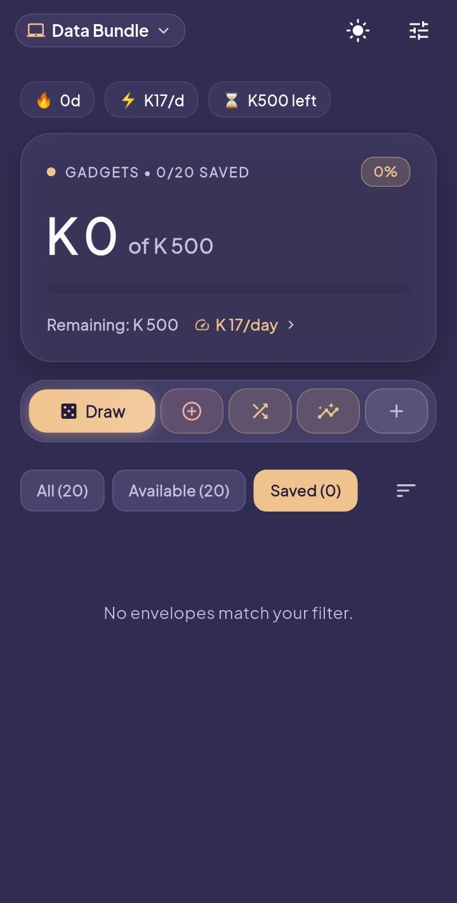
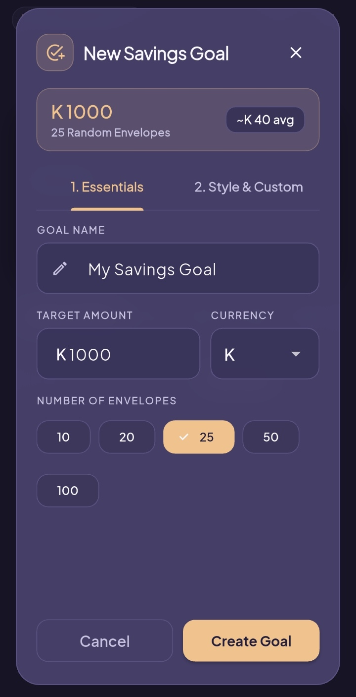
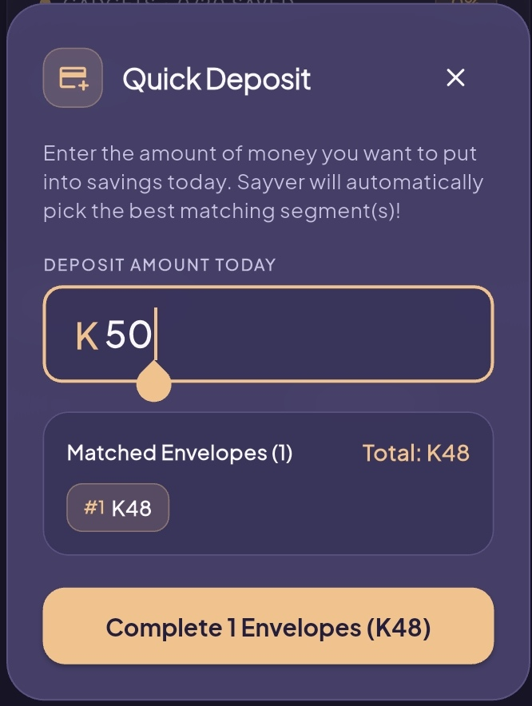
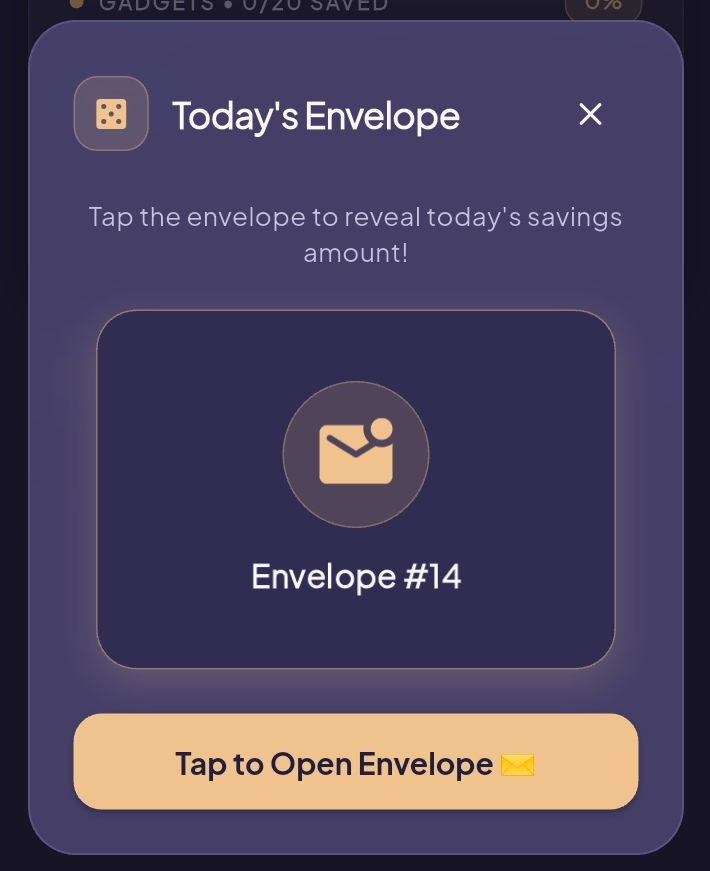
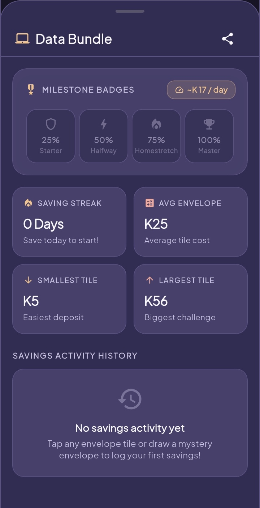
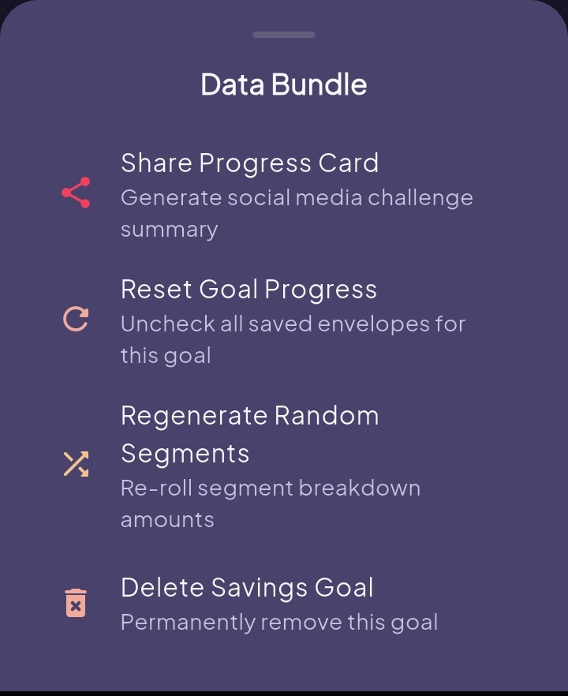

<div align="center">

# Sayver

**A gamified, local-first visual envelope savings challenge and personal financial goal tracker built with Flutter.**

[](https://flutter.dev)
[](https://dart.dev)
[](LICENSE)
[]()
[]()

---

<p align="center">
  
</p>

*Sayver turns abstract savings targets into tactile, achievable milestones through mathematically precise envelope partitioning, mystery draws, and instant budget allocation.*

</div>

---

## Screenshots Gallery

<div align="center">

| [1. Zen Dashboard](docs/screenshots/01_zen_dashboard.jpg) | [2. Goal Creation Flow](docs/screenshots/02_goal_creator_flow.jpg) | [3. Quick Auto-Deposit](docs/screenshots/03_quick_auto_deposit.jpg) |
| :---: | :---: | :---: |
| <a href="docs/screenshots/01_zen_dashboard.jpg"></a> | <a href="docs/screenshots/02_goal_creator_flow.jpg"></a> | <a href="docs/screenshots/03_quick_auto_deposit.jpg"></a> |
| Active goal card, daily saving pace chips, and floating dock | Real-time budget estimator and custom envelope presets | Greedy allocation algorithm matching spare budget to envelopes |

| [4. Mystery Envelope Draw](docs/screenshots/04_mystery_envelope_draw.jpg) | [5. Savings Insights & Milestones](docs/screenshots/05_savings_insights_analytics.jpg) | [6. Goal Actions & Settings](docs/screenshots/06_goal_management_actions.jpg) |
| :---: | :---: | :---: |
| <a href="docs/screenshots/04_mystery_envelope_draw.jpg"></a> | <a href="docs/screenshots/05_savings_insights_analytics.jpg"></a> | <a href="docs/screenshots/06_goal_management_actions.jpg"></a> |
| Gamified randomized envelope selector for daily habits | Milestone badges (25%-100%), streaks, and tile stats | Share progress cards, re-roll algorithms, and reset actions |

</div>

### Screen Overview & Key Mechanics

- **[Zen Dashboard](docs/screenshots/01_zen_dashboard.jpg)**: The primary command center displaying active goal progression (`K 0 of K 500`), remaining balance pace calculation (`~K 17/day`), consecutive streak counter, and the ergonomic bottom dock for one-handed navigation.
- **[Goal Creation Flow](docs/screenshots/02_goal_creator_flow.jpg)**: Fast goal setup with live average-per-envelope estimation (`~K 40 avg`), custom currency selection, and instant preset chips (`10`, `20`, `25`, `50`, `100` envelopes).
- **[Quick Auto-Deposit Calculator](docs/screenshots/03_quick_auto_deposit.jpg)**: Smart lump-sum allocator that greedily finds and fulfills the optimal combination of envelopes for any spare cash amount (e.g. `K 50` $\rightarrow$ envelope `#1 K 48`).
- **[Mystery Envelope Draw](docs/screenshots/04_mystery_envelope_draw.jpg)**: Interactive daily draw modal presenting an uncompleted envelope at random to eliminate decision paralysis and motivate daily contributions.
- **[Savings Insights & Milestone Badges](docs/screenshots/05_savings_insights_analytics.jpg)**: Granular metrics screen tracking unlocked milestone tiers (`25% Starter`, `50% Halfway`, `75% Homestretch`, `100% Master`), savings streaks, envelope size stats (average, smallest, largest), and chronological deposit history.
- **[Goal Actions & Management](docs/screenshots/06_goal_management_actions.jpg)**: Contextual action sheet for generating branded social share challenge cards, re-rolling segment algorithms, resetting progress, or deleting goals.

---

## Key Features

- **Dynamic Envelope Partitioning Engine**: Automatically breaks down any target amount into an exact number of envelopes (10, 25, 50, 52-Week Challenge, 100 Envelopes, or custom counts).
- **Mathematical Exactness**: Guarantees that the cumulative sum of all generated envelopes matches the target amount to the penny with zero floating-point drift.
- **Three Challenge Distribution Algorithms**:
  - `Random Variety`: High-variance envelope amounts for unexpected daily excitement.
  - `Balanced Mix`: Tightly clustered values centered around your daily saving target.
  - `Sequential Challenge`: Strictly incremental envelope series (ideal for the 52-week or 100-envelope challenge).
- **Interactive 3D Mystery Draw**: Smooth tactile card flip animation that selects an uncompleted envelope for today's savings action.
- **Quick Auto-Deposit Engine**: Enter any spare amount (e.g. $50 or K150), and Sayver greedily identifies and marks the optimal combination of envelopes to fulfill that deposit.
- **Analytics & Savings Streak Tracker**: Tracks consecutive saving days, calculates smallest/average/largest envelope sizes, and maintains a chronological savings log.
- **Local-First & Zero Tracking**: All financial data stays strictly on your device using cached `SharedPreferences`. No accounts, no external tracking, no cloud dependencies.
- **Ergonomic Modern Design**: Built around a custom high-contrast palette (`#312C51` Deep Navy, `#48426D` Muted Slate, `#F0C38E` Warm Peach, and `#F1AA9B` Soft Coral) with fluid Material 3 animations and typography powered by Plus Jakarta Sans.
- **Dynamic Dark & Light Themes**: Seamless instant switching between a deep night canvas and a clean light theme.
- **Social Challenge Share**: Copy a progress summary card with completion percentage and current streak to share on social channels.

---

## Architecture & Technical Design

Sayver is structured following clean, modular domain boundaries:

```
lib/
├── main.dart                   # Application entry point, theme lifecycle & Zen dashboard
├── models/
│   └── savings_goal.dart       # Core models: SavingsGoal, SavingsSegment & distribution types
├── services/
│   ├── segment_generator.dart  # Deterministic partitioning algorithms & rounding logic
│   └── storage_service.dart    # Robust local-first SharedPreferences persistence layer
├── theme/
│   └── app_theme.dart          # Unified Material 3 design tokens & typography configurations
└── widgets/
    ├── analytics_view.dart            # Streak stats, envelope distribution metrics & history
    ├── auto_deposit_dialog.dart       # Lump-sum greedy envelope matching calculator
    ├── celebration_dialog.dart        # Victory screen on 100% goal achievement
    ├── confetti_overlay.dart          # Celebration particle burst controller
    ├── create_goal_dialog.dart        # Goal creator with live estimation & challenge presets
    ├── envelope_tile.dart             # Responsive envelope grid item with tactile states
    ├── goal_header_card.dart          # Zen hero card with glowing progress bar & daily pace
    ├── savings_jar_visualizer.dart    # Milestone badges (25%, 50%, 75%, 100%)
    ├── segment_detail_dialog.dart     # Envelope inspector with custom transaction notes
    ├── share_progress_dialog.dart     # Clipboard challenge formatter with mini tile preview
    └── surprise_envelope_dialog.dart  # 3D animated card flip mystery drawer
```

### Exact Partitioning Algorithm (`SegmentGenerator`)

When dividing an arbitrary target amount $T$ into $N$ envelopes:
1. **Raw Distribution Generation**:
   $$\text{EnvelopeSeries}: w_i = \frac{i}{\sum_{k=1}^N k} \cdot T$$
   $$\text{Balanced}: w_i \sim \mathcal{U}(0.4\bar{w}, 1.6\bar{w}) \quad \text{normalized to } T$$
   $$\text{Random}: w_i \sim \mathcal{U}(0, 1)^{1.5} + 0.1 \quad \text{normalized to } T$$
2. **Precision Quantization**: Each raw amount is rounded according to the user's decimal preference (`allowCents`).
3. **Delta Correction**: Any rounding discrepancy $\Delta = T - \sum_{i=1}^N r_i$ is distributed in discrete increments of $\pm 0.01$ (or $\pm 1.0$) across segments until the total equals $T$ exactly.

---

## Getting Started

### Prerequisites

- [Flutter SDK](https://docs.flutter.dev/get-started/install) (version 3.10.3 or higher)
- [Dart SDK](https://dart.dev/get-dart) (included with Flutter)
- Android Studio / Xcode (for native mobile compilation) or Chrome (for web execution)

### Installation

1. **Clone the repository**:
   ```bash
   git clone https://github.com/chipulacollins/sayver.git
   cd sayver
   ```

2. **Install dependencies**:
   ```bash
   flutter pub get
   ```

3. **Verify analyzer integrity**:
   ```bash
   flutter analyze
   ```

4. **Run test suite**:
   ```bash
   flutter test
   ```

5. **Launch application**:
   ```bash
   # Launch on Chrome / Web
   flutter run -d chrome

   # Launch on connected Android/iOS device
   flutter run
   ```

---

## Testing

Sayver features comprehensive unit and widget tests covering:
- Mathematical exactness across all distribution curves.
- Edge case resilience (single envelope, cents precision, small targets, 100-envelope challenge).
- Model serialization, pace calculations, and milestone triggers.
- Local storage operations and corrupt JSON recovery.
- Full UI integration flows (goal creation, envelope toggling, auto-deposit, mystery draw).

Run all tests with execution details:
```bash
flutter test --reporter=expanded
```

---

## Building for Production

### Android (Release APK / App Bundle)
```bash
# 1. Copy template and configure release signing
cp android/key.properties.example android/key.properties

# 2. Build release bundle
flutter build appbundle --release
```

### Web
```bash
flutter build web --release
```

### Desktop (Windows / macOS / Linux)
```bash
flutter build windows --release
flutter build macos --release
flutter build linux --release
```

---

## License

This project is licensed under the MIT License - see the [LICENSE](LICENSE) file for details.

Developed with precision by [Chipula Collins](https://github.com/chipulacollins).
